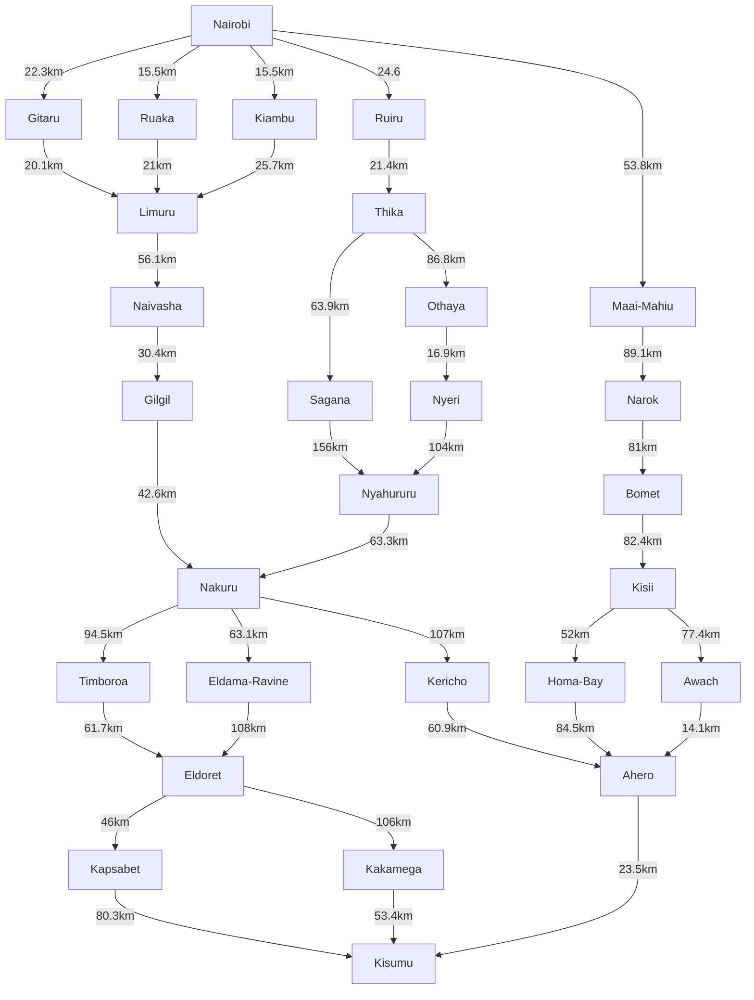

## 1. PEAS Framework & Environment Characteristics
#### A. PEAS Framework for the Self-Driving Trailer Agent
**Performance Measure:**
Find a successfull route to reach the destination (Kisumu from Nairobi).
Use minimal computation time to find the route.
Minimize total distance travelled along said route.
Trip duration and whether delivery deadlines are met.
Safety (no collisions), rule compliance (obeying speed limits, lane keeping), and passenger/cargo comfort (smooth braking and maintaining stable movement during transportation.).

**Environment:**
The physical highway network in Kenya (specifically Nairobi, Central Highlands, Rift Valley, and Lake Victoria Basin) including the A104, B1, B3, and A1 corridors. 
Different road conditions, road construction areas, speed bumps, potholes, and changes in terrain such as the Rift Valley escarpments. Other road users, including heavy trucks, matatus, passenger vehicles, motorcycles (boda-bodas), pedestrians, and wandering livestock. Weather conditions such as heavy rain and fog, especially around areas such as Limuru and Mau Summit.
Google Maps data representation of these regions with locations(nodes), roads(edges) and distances(weights/costs).

**Actuators:**
The mechanism to output the calculated optimal path like a GUI display showing the route, a printed list of waypoints, or map rendering.
Hardware components: Electronic throttle/accelerator control. Air-braking system and retarder. Steering mechanisms for controlling the steering angle. Transmission and gear selection. Signalling and lighting systems, including turn indicators, headlights, brake lights, and hazard lights.

**Sensors:**
Google Maps Search/Directions API used to retrieve nodes, edges, and distance inputs.
User interface to receive input about starting point and destination.
Real-time monitoring through cameras (for lane detection, traffic lights, obstacles), long-range LiDAR and radar for detecting obstacles and supporting adaptive cruise control. Cameras for detecting lanes, road signs, traffic lights, and pedestrians. GPS/GNSS and an IMU (Inertial Measurement Unit) for determining the vehicle’s position and orientation. Wheel-speed sensors and engine diagnostics for monitoring vehicle speed, fuel level, tyre pressure, and other vehicle conditions.

#### B. Environment Dimensions
1. **Partially Observable vs. Fully Observable:** **Partially Observable.** The trailer agent cannot know everything happening on the road at a given time. It may not know about traffic jams ahead, broken-down vehicles or sudden changes in weather around areas like Mau Summit.

2. **Deterministic vs. Stochastic:** **Stochastic.** Road and traffic conditions can change unexpectedly. Other drivers may behave unpredictably, pedestrians may cross the road suddenly and weather conditions may change, making it difficult to predict the exact outcome of an action.

3. **Episodic vs. Sequential:** **Sequential.** Each decision affects what happens next. For example, choosing a route through the A104 instead of the B3 via Narok affects the distance travelled, fuel consumption and the route options available later.

4. **Static vs. Dynamic:** **Dynamic.** The road environment changes while the agent is making decisions. Traffic levels, the positions of other vehicles and road conditions can change at any time.

5. **Discrete vs. Continuous:** **Continuous.** The trailer's speed, position, steering angle and distance travelled can take different values within a range. However, when planning routes, road junctions can be represented as discrete points on a map.

## 2. Directed Graph & Search Tree (with Abstraction)
#### A. Directed Graph of Candidate Road Networks

### Applying Abstraction (removing unnecessary details)
* We ignore:
  *the physical curvature of the roads, speed limits, traffic lights, and scenery.
  *minor villages or sub-locations.

* We model the environment as a directed graph using:
  * **Nodes (Vertices):** Major towns (Nairobi, Naivasha, Nakuru, Kericho, Eldoret, Kisumu, Narok, Bomet, etc.).
  * **Edges (Arcs):** The major highways connecting these towns.

### Developing the Directed Graph

Using the Google Maps view of the specified Kenyan regions, we extracted a simplified graph with these connections:

#### B. Search Tree (Applying Abstraction)

```mermaid
graph TD
    N[Nairobi] -->|22.3km| Git[Gitaru]
    N -->|15.5km| Rua[Ruaka]
    N -->|15.5km| Kia[Kiambu]
    N -->|24.6km| Rui[Ruiru]
    N -->|53.8km| MM[Maai-Mahiu]

    %% Branch 1: Gitaru
    Git -->|20.1km| Lim1[Limuru]
    Lim1 -->|56.1km| Nai1[Naivasha]
    Nai1 -->|30.4km| Gil1[Gilgil]
    Gil1 -->|42.6km| Nak1[Nakuru]
    Nak1 -->|94.5km| Tim1[Timboroa]
    Tim1 -->|61.7km| Eld1A[Eldoret]
    Eld1A -->|46km| Kap1A[Kapsabet]
    Kap1A -->|80.3km| Kisumu1A[Kisumu]
    Eld1A -->|106km| Kak1A[Kakamega]
    Kak1A -->|53.4km| Kisumu1B[Kisumu]
    Nak1 -->|63.1km| ER1[Eldama-Ravine]
    ER1 -->|108km| Eld1B[Eldoret]
    Eld1B -->|46km| Kap1B[Kapsabet]
    Kap1B -->|80.3km| Kisumu1C[Kisumu]
    Eld1B -->|106km| Kak1B[Kakamega]
    Kak1B -->|53.4km| Kisumu1D[Kisumu]
    Nak1 -->|107km| Ker1[Kericho]
    Ker1 -->|60.9km| Ahe1[Ahero]
    Ahe1 -->|23.5km| Kisumu1E[Kisumu]

    %% Branch 2: Ruaka
    Rua -->|21km| Lim2[Limuru]
    Lim2 -->|56.1km| Nai2[Naivasha]
    Nai2 -->|30.4km| Gil2[Gilgil]
    Gil2 -->|42.6km| Nak2[Nakuru]
    Nak2 -->|94.5km| Tim2[Timboroa]
    Tim2 -->|61.7km| Eld2A[Eldoret]
    Eld2A -->|46km| Kap2A[Kapsabet]
    Kap2A -->|80.3km| Kisumu2A[Kisumu]
    Eld2A -->|106km| Kak2A[Kakamega]
    Kak2A -->|53.4km| Kisumu2B[Kisumu]
    Nak2 -->|63.1km| ER2[Eldama-Ravine]
    ER2 -->|108km| Eld2B[Eldoret]
    Eld2B -->|46km| Kap2B[Kapsabet]
    Kap2B -->|80.3km| Kisumu2C[Kisumu]
    Eld2B -->|106km| Kak2B[Kakamega]
    Kak2B -->|53.4km| Kisumu2D[Kisumu]
    Nak2 -->|107km| Ker2[Kericho]
    Ker2 -->|60.9km| Ahe2[Ahero]
    Ahe2 -->|23.5km| Kisumu2E[Kisumu]

    %% Branch 3: Kiambu
    Kia -->|25.7km| Lim3[Limuru]
    Lim3 -->|56.1km| Nai3[Naivasha]
    Nai3 -->|30.4km| Gil3[Gilgil]
    Gil3 -->|42.6km| Nak3[Nakuru]
    Nak3 -->|94.5km| Tim3[Timboroa]
    Tim3 -->|61.7km| Eld3A[Eldoret]
    Eld3A -->|46km| Kap3A[Kapsabet]
    Kap3A -->|80.3km| Kisumu3A[Kisumu]
    Eld3A -->|106km| Kak3A[Kakamega]
    Kak3A -->|53.4km| Kisumu3B[Kisumu]
    Nak3 -->|63.1km| ER3[Eldama-Ravine]
    ER3 -->|108km| Eld3B[Eldoret]
    Eld3B -->|46km| Kap3B[Kapsabet]
    Kap3B -->|80.3km| Kisumu3C[Kisumu]
    Eld3B -->|106km| Kak3B[Kakamega]
    Kak3B -->|53.4km| Kisumu3D[Kisumu]
    Nak3 -->|107km| Ker3[Kericho]
    Ker3 -->|60.9km| Ahe3[Ahero]
    Ahe3 -->|23.5km| Kisumu3E[Kisumu]

    %% Branch 4: Ruiru (Thika)
    Rui -->|21.4km| Thi[Thika]
    Thi -->|63.9km| Sag[Sagana]
    Sag -->|156km| Nya1[Nyahururu]
    Nya1 -->|63.3km| Nak4[Nakuru]
    Nak4 -->|94.5km| Tim4[Timboroa]
    Tim4 -->|61.7km| Eld4A[Eldoret]
    Eld4A -->|46km| Kap4A[Kapsabet]
    Kap4A -->|80.3km| Kisumu4A[Kisumu]
    Eld4A -->|106km| Kak4A[Kakamega]
    Kak4A -->|53.4km| Kisumu4B[Kisumu]
    Nak4 -->|63.1km| ER4[Eldama-Ravine]
    ER4 -->|108km| Eld4B[Eldoret]
    Eld4B -->|46km| Kap4B[Kapsabet]
    Kap4B -->|80.3km| Kisumu4C[Kisumu]
    Eld4B -->|106km| Kak4B[Kakamega]
    Kak4B -->|53.4km| Kisumu4D[Kisumu]
    Nak4 -->|107km| Ker4[Kericho]
    Ker4 -->|60.9km| Ahe4[Ahero]
    Ahe4 -->|23.5km| Kisumu4E[Kisumu]

    %% Branch 4b: Ruiru (Othaya)
    Thi -->|86.8km| Oth[Othaya]
    Oth -->|16.9km| Nye[Nyeri]
    Nye -->|104km| Nya2[Nyahururu]
    Nya2 -->|63.3km| Nak5[Nakuru]
    Nak5 -->|94.5km| Tim5[Timboroa]
    Tim5 -->|61.7km| Eld5A[Eldoret]
    Eld5A -->|46km| Kap5A[Kapsabet]
    Kap5A -->|80.3km| Kisumu5A[Kisumu]
    Eld5A -->|106km| Kak5A[Kakamega]
    Kak5A -->|53.4km| Kisumu5B[Kisumu]
    Nak5 -->|63.1km| ER5[Eldama-Ravine]
    ER5 -->|108km| Eld5B[Eldoret]
    Eld5B -->|46km| Kap5B[Kapsabet]
    Kap5B -->|80.3km| Kisumu5C[Kisumu]
    Eld5B -->|106km| Kak5B[Kakamega]
    Kak5B -->|53.4km| Kisumu5D[Kisumu]
    Nak5 -->|107km| Ker5[Kericho]
    Ker5 -->|60.9km| Ahe5[Ahero]
    Ahe5 -->|23.5km| Kisumu5E[Kisumu]

    %% Branch 5: Maai-Mahiu
    MM -->|89.1km| Nar[Narok]
    Nar -->|81km| Bom[Bomet]
    Bom -->|82.4km| Kisii[Kisii]
    Kisii -->|52km| HB[Homa-Bay]
    HB -->|84.5km| Ahe6[Ahero]
    Ahe6 -->|23.5km| Kisumu6A[Kisumu]
    Kisii -->|77.4km| Awa[Awach]
    Awa -->|14.1km| Ahe7[Ahero]
    Ahe7 -->|23.5km| Kisumu6B[Kisumu]
```

## 3. Path Cost Function & Optimal Path Determination
#### A. Distance Breakdown by Road Segment
#### B. Route Path Cost Evaluation
#### C. Optimal Path Conclusion

## 4. Group Work Evidence
### Meeting Minutes
- **Date**: 07/10/2026
- **Platform**: Google Meet
- **Members Present**: Albert Miricho (189990), Sean Ndung'u (191602), Sydney Aisha (190497)
- **Agenda**:
  1. Problem formulation and PEAS definition.
  2. Construction of a highway-directed graph and abstraction tree.
  3. Distance verification on Google Maps.
  4. Repository fork verification and Markdown documentation compilation.

#### Team Photo
(./team_photo.jpg)
